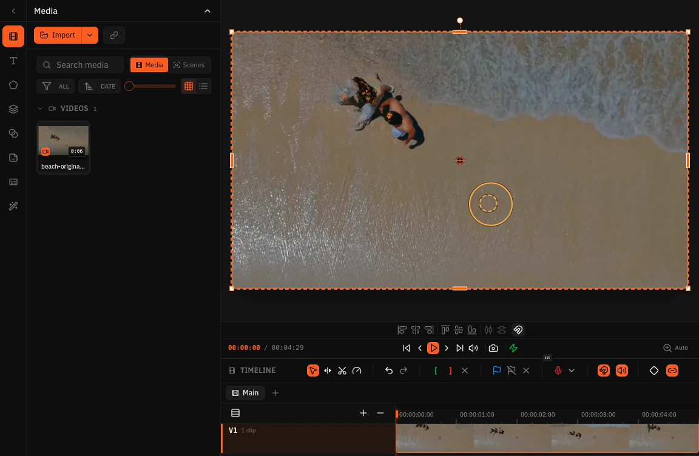

<p align="center">
  <a href="https://droneclean.app/de/"></a>
</p>

<h1 align="center">DroneClean Studio</h1>

<p align="center">
  <a href="README.md">English</a> &nbsp;·&nbsp;
  <a href="README.it.md">Italiano</a> &nbsp;·&nbsp;
  <a href="README.es.md">Español</a> &nbsp;·&nbsp;
  <a href="README.fr.md">Français</a> &nbsp;·&nbsp;
  <strong>Deutsch</strong> &nbsp;·&nbsp;
  <a href="README.pt-BR.md">Português (Brasil)</a> &nbsp;·&nbsp;
  <a href="README.tr.md">Türkçe</a> &nbsp;·&nbsp;
  <a href="README.ja.md">日本語</a> &nbsp;·&nbsp;
  <a href="README.ko.md">한국어</a> &nbsp;·&nbsp;
  <a href="README.zh.md">简体中文</a>
</p>

<p align="center">
  <strong>Ein kostenloser, lokal arbeitender Videoeditor für FPV- und Drohnenpiloten.</strong><br>
  Stabilisierung per Gyro, D-Log-M-Farbe, weiche Geschwindigkeitsrampen mit Optical-Flow-Zeitlupe und ein MCP-Server für KI-Agenten.
</p>

<p align="center">
  <a href="https://github.com/matteodante/droneclean-studio/releases/latest"></a>
  <a href="LICENSE"></a>
  
</p>

<p align="center">
  <a href="https://github.com/matteodante/droneclean-studio/releases/latest/download/DroneClean-Studio-arm64.dmg"><strong>Für Mac herunterladen</strong></a>
  &nbsp;·&nbsp;
  <a href="https://github.com/matteodante/droneclean-studio/releases/latest/download/DroneClean-Studio-x64.exe"><strong>Für Windows herunterladen</strong></a>
  &nbsp;·&nbsp;
  <a href="https://droneclean.app/de/studio/"><strong>Im Browser öffnen</strong></a>
  &nbsp;·&nbsp;
  <a href="https://droneclean.app/de/">droneclean.app</a>
</p>

Das Video oben zeigt Claude Code, wie es sechs DJI-Avata-2-Clips über den MCP-Server des Editors schneidet, ohne dass
eine Hand die Maus berührt. Es liest die Beats des Songs, wählt von jedem Clip ein paar Sekunden aus und schneidet sie
auf den Beat, stabilisiert sie anhand der Gyro-Daten, wandelt die D-Log-M-Farbe um, gibt jeder Einstellung eine
Geschwindigkeitsrampe mit Optical-Flow-Zeitlupe und Bewegungsunschärfe und sieht sich die Bilder an, um Personen und
Autos auszusparen. Die 19 Minuten, die es dafür brauchte, sind 47-fach beschleunigt zu sehen. Jede seiner Änderungen
ist ein ganz normaler Schritt im Editor, den du rückgängig machen oder von Hand weiterbearbeiten kannst.

## Vorher und nachher

<p align="center">
  
</p>

Die ersten 24 Sekunden eines Reels, das in DroneClean Studio aus Clips desselben Flugs geschnitten wurde. Links die
Schnitte wie gefilmt: flache D-Log-M-Farbe, das Zittern der Drohne, echte Geschwindigkeit. Rechts der fertige Schnitt:
anhand der Gyro-Daten stabilisiert, D-Log M umgewandelt und gegradet, mit Geschwindigkeitsrampen,
Optical-Flow-Zeitlupe und Bewegungsunschärfe.

## Funktionen

- **Stabilisierung per Gyro.** DJI- und GoPro-Dateien enthalten die Bewegung der Kamera; Studio stabilisiert sie mit
  der Engine von [Gyroflow](https://github.com/gyroflow/gyroflow), kompiliert zu WebAssembly, ganz ohne
  Analysedurchlauf. Ein 4:3-Clip in einem 9:16-Projekt füllt das Hochformat von selbst, und ein per Keyframes
  animierbarer Bildausschnitt hält das Motiv im Bild.
- **Farbe für Drohnenaufnahmen.** DJI D-Log M und D-Log nach Rec.709, kreative Looks aus `.cube`-Dateien, Farbräder,
  Kurven, sekundäre Qualifier, Power Windows und ein Himmelsverlauf für ausgewaschene Himmel.
- **Geschwindigkeit.** Geschwindigkeitskurven mit weichen Übergängen und ein Ein-Klick-Befehl „weiche Rampe + Zoom“.
  Die Bewegungsunschärfe folgt der Bewegung jedes Pixels entlang des Optical Flows, und die Zeitlupe erzeugt daraus neue
  Bilder, statt vorhandene zu wiederholen. Beat-Marker aus dem Song.
- **Keyframes** für jede Eigenschaft und jeden Effektparameter, mit Bézier- und Federkurven.
- **Export.** Voreinstellungen für YouTube 4K und Instagram Reels sowie 10-Bit-Master (ProRes 422 HQ, HEVC Main 10) in
  der Desktop-App.
- **KI-Agenten.** Ein lokaler MCP-Server: Claude oder ein anderer MCP-Client kann ein Projekt aufbauen, gradieren und
  exportieren, über dasselbe SDK, das auch der Editor nutzt, und jede Änderung ist ein Rückgängig-Schritt.
- **Entfernen des Drohnenschattens**, der einzige kostenpflichtige Effekt, über den DroneClean-Cloud-Dienst.
- **Lokal zuerst.** Projekte und Medien bleiben in einem Ordner deiner Wahl; Aufnahmen verlassen deinen Computer nur,
  wenn du einen Ausschnitt zum Entfernen des Schattens sendest.

<p align="center">
  
</p>

## Installation

**Mac (Apple Silicon):** Lade das Disk-Image aus der [neuesten Version](../../releases/latest) herunter und ziehe
DroneClean Studio in den Ordner „Programme“. Dieses Build ist noch nicht von Apple signiert, deshalb stoppt macOS es
beim ersten Mal: Öffne es einmal, gehe dann zu Systemeinstellungen › Datenschutz & Sicherheit und klicke auf
**Trotzdem öffnen**.

**Windows 10 und 11 (x64):** Lade `DroneClean-Studio-x64.exe` aus der [neuesten Version](../../releases/latest) herunter
und führe die Datei aus; sie wird für deinen Benutzer installiert, ohne Administrator-Abfrage. Sie ist noch nicht
signiert, deshalb stoppt SmartScreen sie beim ersten Mal: Wähle **Weitere Informationen › Trotzdem ausführen**. Sie
bringt ihr eigenes FFmpeg mit Encodern für NVIDIA, Intel und AMD mit.

**Browser:** [droneclean.app/studio](https://droneclean.app/de/studio/) führt denselben Editor in Chrome oder Edge auf
einem Computer aus (er benötigt die File System Access API).

## Mit einem KI-Agenten nutzen

Der Agentenzugriff ist in der Desktop-App standardmäßig aktiviert (nur dein Benutzer kann darauf zugreifen;
**Einstellungen › Agenten-Zugriff › KI-Agenten erlauben** schaltet ihn ab), und dieses Fenster zeigt den genauen Befehl.
Für Claude Code auf einem Mac:

```sh
claude mcp add droneclean -- "/Applications/DroneClean Studio.app/Contents/Resources/mcp/droneclean-mcp"
```

Unter Windows nennt der Befehl
`%LOCALAPPDATA%\Programs\DroneClean Studio\resources\mcp\droneclean-mcp.cmd` (das Fenster zeigt ihn mit dem Pfad
deines Benutzers).

Der Server hat vier Werkzeuge: `search` (die SDK-Referenz, das Benutzerhandbuch und die Funktionsübersicht), `run` (ein
Skript gegen das SDK des Editors), `frame` (ein gerendertes Bild oder ein Kontaktbogen) und `export`. Bitte danach in
deinen eigenen Worten um einen Schnitt, wie im Video oben: „Mach einen weichen Drohnenschnitt aus den sechs Clips im
geöffneten Projekt, geschnitten auf den Beat des Songs.“

## Aus dem Quellcode bauen

macOS auf Apple Silicon, Node 24, Rust mit dem Target `wasm32-unknown-unknown`, `wasm-bindgen-cli` 0.2.130 und
`wasm-opt` (Binaryen).

```sh
cd studio && npm ci && cd desktop && npm ci
npm run package        # der Editor, Gyroflows wasm und FFmpeg, dann die App in dist/mac-arm64
```

In `studio/` führt `npm run check:quick` die schnellen Prüfungen aus und `npm run verify` die komplette Suite (sie
benötigt Google Chrome und FFmpeg).

## Aufbau des Repositorys

| Pfad | Was es ist |
| --- | --- |
| `studio/` | Der Editor, ein Fork von [FreeCut](https://github.com/walterlow/freecut) (MIT). Der eigene Code von DroneClean liegt in `studio/src/studio/`. |
| `studio/desktop/` | Die Electron-App, ihr FFmpeg-Build und das Release-Skript. |
| `studio/mcp/` | Der MCP-Starter, den ein Agent startet. |
| `studio/web/` | Der statische Server des Web-Editors. |
| `gyroflow/` | Ein Fork von [Gyroflow](https://github.com/gyroflow/gyroflow) (GPL-3.0); `gyroflow/wasm/` baut dessen Engine für den Editor. |

Dieses Repository wird vom Release-Prozess veröffentlicht: Jede Version ist ein einzelner Commit, hier mit dem Tag
`v0.1.9`.

## Mitmachen und Sicherheit

Fehlerberichte und Ideen sind willkommen: [Eröffne ein Issue](../../issues/new/choose). [CONTRIBUTING.md](CONTRIBUTING.md)
erklärt, wie Änderungen in eine Version gelangen. Melde eine Sicherheitslücke privat, wie es
[SECURITY.md](SECURITY.md) beschreibt, niemals in einem öffentlichen Issue.

## Lizenz und Danksagung

GPL-3.0-or-later (siehe [LICENSE](LICENSE)). DroneClean Studio enthält FreeCut (MIT) und Gyroflow (GPL-3.0); die
Desktop-App enthält FFmpeg (LGPL-2.1), aus dem offiziellen Quellcode gebaut mit `studio/desktop/scripts/build-ffmpeg.sh`.
Der Screenshot zeigt das Pexels-Video 39579103 unter der [Pexels-Lizenz](https://www.pexels.com/license/). Die Demo und
das Vorher-Nachher zeigen das eigene DJI-Avata-2-Material des Autors; sie werden von droneclean.app ausgeliefert und
sind nicht Teil dieses Repositorys oder seiner Lizenz.
